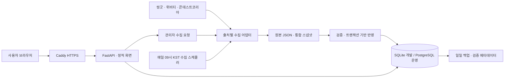
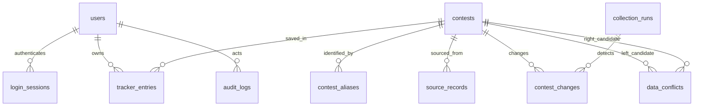

# 아키텍처와 설계 결정

## 구성

프런트엔드는 빌드 도구 없는 HTML/CSS/JavaScript입니다. API가 있으면 서버 페이지네이션을 사용하고, 정적 미리보기에서는 기존 JSON 모드로 동작합니다. 관리자는 같은 서버의 `/admin`에서 운영합니다. 개발은 별도 DB 설치가 필요 없는 SQLite, 운영 구성은 PostgreSQL 17을 사용합니다.

## 핵심 ERD

스키마는 [models.py](../backend/models.py), 최초 버전은 [0001_initial.py](../migrations/versions/0001_initial.py)에 있습니다. 업무 테이블 12개와 `alembic_version`으로 구성합니다. 위 관계 외에 `auth_attempts`는 로그인 시도 제한, `operation_locks`는 수집 동시 실행 제한에 사용합니다.

| 데이터 | 보장하는 조건 |
| --- | --- |
| `contests`, `contest_aliases`, `source_records` | 통합 공고·이전 ID·출처별 원본을 분리하고 기존 링크를 해석 |
| `tracker_entries` | `(user_id, contest_id)` 복합 기본키로 사용자별 기록 분리 |
| `collection_runs`, `contest_changes` | 실행 결과와 필드별 이전·이후 값 추적 |
| `data_conflicts`, `audit_logs` | 후보를 자동 삭제하지 않고 사람의 검토 및 변경 근거 기록 |
| `login_sessions` | 세션·CSRF 토큰 원문이 아닌 해시와 만료 시각 저장 |

## 주요 설계 결정

### 데이터 품질과 보존

제목·주최 기관·마감일을 정규화해 일치하는 공고만 보수적으로 통합합니다. 출처별 ID는 별칭으로 남겨 기존 찜을 이어갑니다. 제목·기관이 같아도 마감일이 다르면 강제 병합하지 않고 관리자 검토 후보로 등록합니다. 검토의 `resolved`·`ignored`는 판단 기록이며 원문이나 공모전을 수정·병합하는 기능은 아닙니다. 이후 정보가 바뀌면 다시 검토 대상으로 열립니다.

접수 상태는 별도 배치가 수정하는 값이 아니라 한국 날짜와 시작일·마감일로 요청 시 계산합니다. 마감한 공고나 최신 스냅샷에서 빠진 공고도 DB에서 삭제하지 않아 찜·메모·제출 기록이 남습니다. 이력은 DB에 처음 반영한 시점부터 기록하며 그 이전의 변경을 소급 복구하지는 않습니다.

스냅샷 전체를 먼저 검증하고 한 트랜잭션으로 반영합니다. 스냅샷 지문에 고유 제약을 두어 동일 입력의 재반영으로 공고·이력이 중복되지 않게 합니다. 외부 수집 실패 시 DB는 이전 성공 상태를 유지합니다. 출처별 부분 실패는 원본 캐시를 사용하므로 관리자 화면에서 출처 상태와 최종 성공 시각을 함께 확인해야 합니다.

### 인증·권한과 충돌 처리

비밀번호는 Argon2로 해시합니다. 로그인은 무작위 세션 토큰을 사용하는 서버 세션이며 쿠키는 `HttpOnly`, `SameSite=Lax`, 운영에서는 `Secure`입니다. 인증이 필요한 쓰기에는 별도 CSRF 토큰과 출처 확인을 적용합니다. 로그아웃은 DB 세션을 폐기하고, 일반 회원가입에는 역할 필드를 허용하지 않습니다. 관리자 권한은 화면 표시가 아니라 API 요청마다 서버에서 검사합니다.

개인 기록 변경은 `version`을 조건으로 하는 원자적 UPDATE/DELETE입니다. 오래된 버전은 HTTP 409로 거절해 여러 기기의 변경을 조용히 덮어쓰지 않습니다. 비회원 기록 가져오기는 명시적으로 요청하며, 진행 단계는 더 앞선 단계, 체크리스트는 합집합, 메모는 문단 중복 제거로 합칩니다. 같은 기록을 다시 가져와도 내용과 버전이 불필요하게 증가하지 않습니다.

### 운영 경계

관리자 수집과 스케줄러는 동일 DB 잠금을 공유합니다. 수집 제한은 20분, 잠금 임대는 1시간이며 중단된 작업의 만료 잠금은 다음 요청 때 회수합니다. 현재는 별도 작업 큐가 아닌 백그라운드 작업·서브프로세스 구조입니다. 장시간·다중 작업이 늘면 영속 작업 큐와 재시도 정책으로 확장할 수 있습니다.

HTTP 요청에 요청 ID·경로·상태 코드·소요 시간을 로그로 남깁니다. 비밀번호·개인 메모·토큰은 이 요청 로그에 기록하지 않습니다. 파일 서버는 공개 파일 목록만 허용하므로 저장소 전체, 환경 설정, DB 파일을 웹으로 노출하지 않습니다.

API 상세는 실행 후 `/docs`에서 확인합니다. 공모전 조회·이력은 공개, 개인 보드는 로그인 필요, 운영·권한·감사 API는 관리자 전용입니다.
